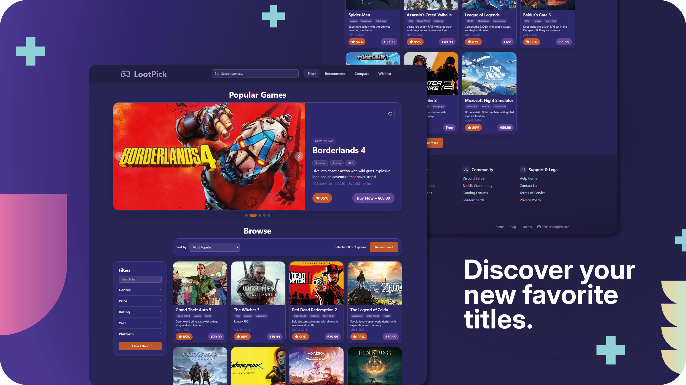
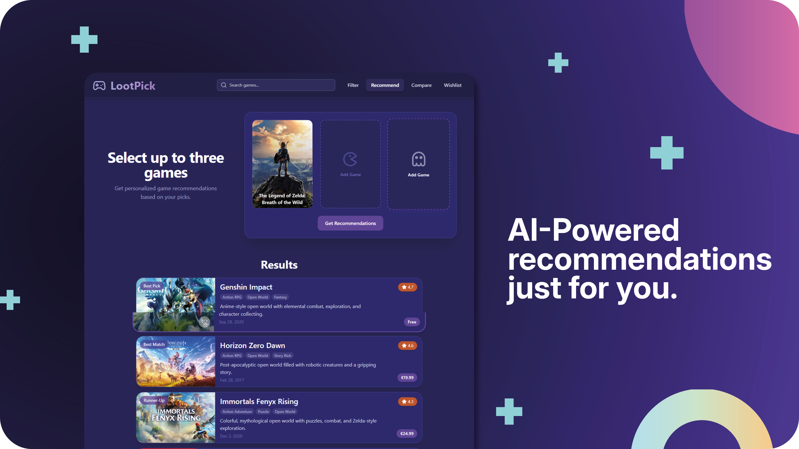
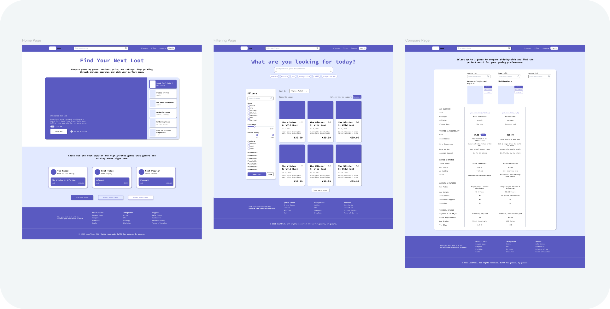
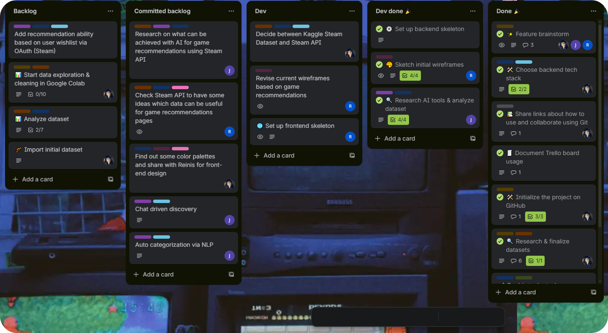
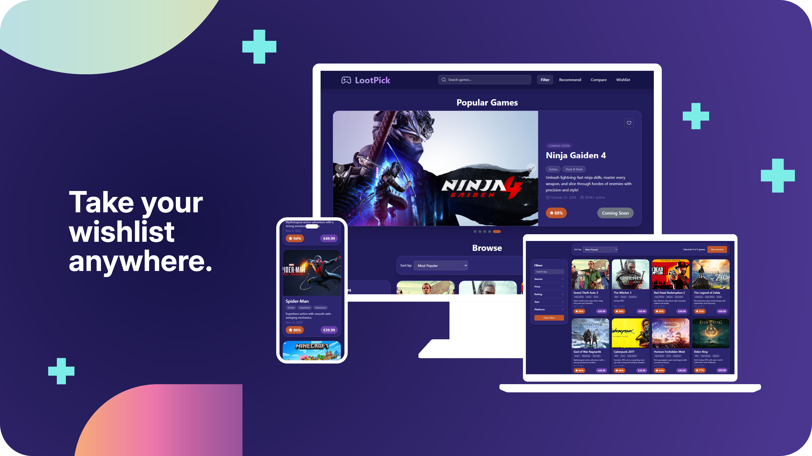
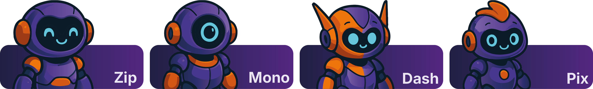

# 🎮 LootPick (Front-End)


[](https://www.techlabs.org/location/rotterdam)

LootPick is a smart discovery website that uses AI to match you with your next favorite video game. It’s your personal gaming companion, allowing you to filter, sort, and explore new and existing titles effortlessly. This project was built over 8 weekends
during [**TechLabs**](https://www.techlabs.org/location/rotterdam) learning
program.

🚀 [**Front-End Live Demo**](https://lootpick-app.netlify.app/)

<br>
<p align="center">
  
</p>
<p align="center"><em>LootPick — A game discovery and sorting site</em></p>

## ✨ Features

- Personalized recommendations powered by AI
- Advanced game discovery with filtering, search, and comparison tools
- Save to wishlist, buy, or explore later
- Interactive UI with sliders and filters
- Modern dark mode colors


<br>
<p align="center">
  
</p>
<p align="center"><em>Get game recommendations based on your favorite titles</em></p>


## 🔍 Challenges & My Approach

| **Challenge**                             | **Approach**                                                                                                                                                |
| ----------------------------------------- | ----------------------------------------------------------------------------------------------------------------------------------------------------------- |
| Managing scope creep from ambitious ideas | Defined a clear MVP and organized tasks with Trello.                                                                                                        |
| Designing UI from scratch                 | Researched references and created wireframes in [Figma](https://www.figma.com/design/yK1ZpChLzhRBbyoyQu93vB/LootPick-App?node-id=0-1&t=lY4PwSllHDq0UtIA-1). |
| Building a web app under time pressure    | Selected React for its component-based architecture and mature ecosystem.                                                                                   |
| Rapid prototyping of components            | Used v0 and Replit to quickly generate basic layouts.                                                                                                        |
| Styling consistent UI components          | Used a Tailwind-only approach for the app’s appearance and styling.                                                                                                     |
| Creating flexible range-based filters     | Integrated rc-slider for customizable range sliders.                                                                                                        |
| Maintaining consistent code style         | Used Prettier for automated formatting.                                                                                                                     |


<br>
<p align="center">
  
</p>
<p align="center"><em>Figma Low-fidelity wireframes</em></p>


## 🗂️ App Structure

<details>
  <summary>Expand front-end
   directory</summary>

```bash
src/
├── App.js                # Root React component and routing
├── assets/               # Static files (images, logos, etc.)
├── components/           # Reusable UI components
├── context/              # React context providers
├── data/                 # Temporary mock data used before API integration
├── pages/                # Page components
│   ├── Compare Page/     # Game comparison features
│   ├── Filter Page/      # Game filtering and search
│   ├── Recommend Page/   # Game recommendations
│   └── Wishlist Page/    # User's wishlist management
└── styles/               # Global styles and theming
```

</details>

## 👥 Team

- 🧑 [Reinis Pakulis](https://nl.linkedin.com/in/reinis-pakulis) – UX/UI
  designer, Front-End Developer _(I’m here!)_
- 👩‍💻 Aylin Gümüş – Data Science, Back-End Developer
- 👨‍💻 Johannes Fourie – AI, Machine Learning


<br>
<p align="center">
  
</p>
<p align="center"><em>Project planning and task management using Trello.</em></p>


## 🚀 Future Work

- Expand to tablet/mobile layouts
- Develop a wishlist feature so users can bookmark gamess
- Introduce a comparison page for side-by-side evaluation
- Integrate backend APIs for live data and AI recommendations
- Add an AI buddy to guide users and assist with game discovery
- Add user accounts to save preferences
- Improve animations, transitions & routing
- Optimize image loading & performance
- Develop cross-platform mobile versions


<br>
<p align="center">
  
</p>
<p align="center">
  
</p>
<p align="center"><em>Multi-device expansion and AI buddy development</em></p>


## ⚙️ Running Locally

<details> <summary>Instructions</summary>
This project was bootstrapped with Create React App. To run this project locally:
<br><br>

```
git clone https://github.com/aylingumus/lootpick.git
cd lootpick
npm install
npm start
```

Open http://localhost:3000 in your browser.

_Currently uses static data; Back-End integration planned._

</details>

## 📄 License

This project is for educational purposes. Feel free to fork and experiment with
it!
